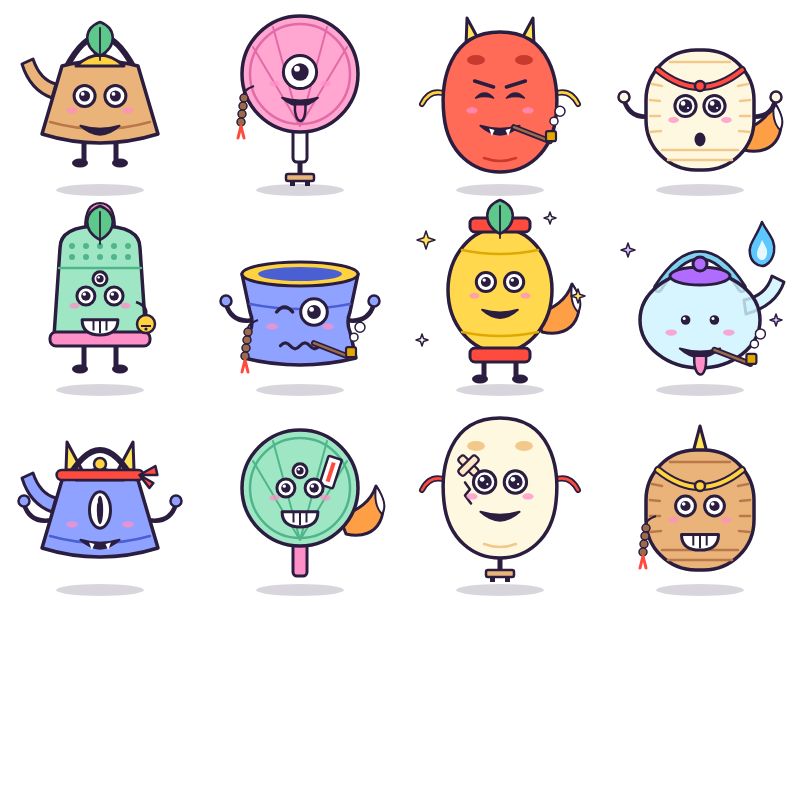
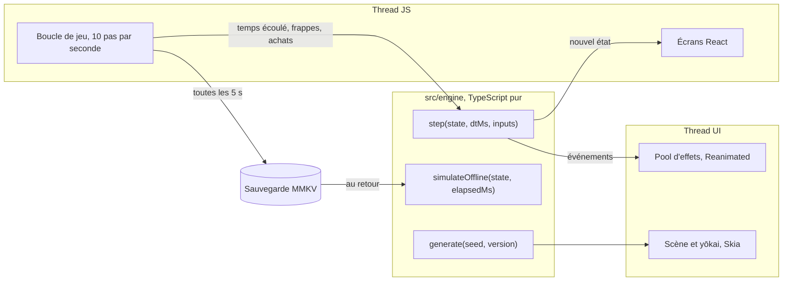

# Hyakki : étude de cas

> 百鬼夜行 — le défilé des cent démons.

Hyakki est un idle RPG mobile (iOS et Android) de fantasy japonaise, en style cartoon/animé. Un jeune onmyōji purifie un défilé infini de yōkai ; chacun peut rejoindre son équipe comme shikigami. Le jeu est **100 % gratuit et hors ligne** : ni publicité, ni achat intégré, ni compte, ni serveur, aucune donnée collectée. C'est un projet vitrine du studio **Parallax Works**.

| | |
|---|---|
| Plateformes | iPhone et Android, une seule base de code |
| Stack | Expo SDK 58 (React Native 0.88, React 19), TypeScript strict, Skia, Reanimated 4, MMKV, zustand |
| Qualité | Jest et fast-check (au moins 90 % des lignes du moteur couvertes), Maestro pour les parcours, règles d'architecture vérifiées par ESLint, CI GitHub Actions |
| Contenu | 1 245 696 yōkai différents générés en code, 10 Gardiens illustrés, 10 poses du héros |
| Stores | Google Play et App Store : liens à venir |

## Le défi

Un idle RPG vit de sa variété : des milliers d'ennemis à enchaîner, chacun doit avoir l'air nouveau. Sans budget d'illustration ni serveur, il fallait :

- produire un contenu quasi illimité sans planche de sprites ;
- garder une partie cohérente hors ligne, sur des heures d'absence ;
- manipuler des nombres qui dépassent `1e308` ;
- donner au combat l'énergie d'un animé à 60 images par seconde sur un téléphone d'entrée de gamme.

## Un générateur à graine

Les yōkai ordinaires sont des *tsukumogami*, ces objets du quotidien qui prennent vie après cent ans. Le générateur assemble un objet, des yeux, une bouche, des membres et des accessoires vectoriels à partir d'une graine :

- **Même graine, même yōkai**, sur toutes les plateformes et toutes les versions. L'ordre des tirages est un contrat : un changement qui modifierait une graine existante crée une nouvelle version du générateur, et chaque shikigami garde la version de sa capture.
- **L'apparence fixe les stats** : trois yeux donnent des critiques, des cornes de l'attaque, un onibi brûle l'ennemi. Le visuel porte du gameplay au lieu d'être un simple habillage.
- **285 696 combinaisons en V1, 1 245 696 en V2** (six objets et quatre accessoires ajoutés sans toucher aux graines existantes).
- Le prototype HTML du générateur ([`design/prototypes/fabrique-a-yokai.html`](../design/prototypes/fabrique-a-yokai.html)) sert de référence : les tests exécutent le prototype dans Node et comparent le moteur avec lui sur les 10 000 premières graines.

Détails : [`PROCEDURAL_YOKAI.md`](PROCEDURAL_YOKAI.md).

## Un moteur en TypeScript pur

Le moteur ne connaît ni React, ni l'horloge, ni le hasard du système : c'est une fonction de transition. L'interface lui donne le temps écoulé et les actions du joueur, il rend le nouvel état et les événements à animer.

- **Déterminisme** : découper une durée en plusieurs pas donne exactement le même résultat. Des tests de propriétés (fast-check) le vérifient sur des cas tirés au hasard, comme l'économie et la sauvegarde.
- **Hors ligne analytique** : au retour, le jeu calcule l'absence vague par vague, en segments, au lieu de rejouer des millions de pas. Une horloge système qui recule ne donne jamais de gains.
- **Grands nombres** : `break_infinity.js` derrière un adaptateur `BigNum` ; une règle de lint interdit de l'importer ailleurs.
- **Frontières vérifiées** : ESLint refuse qu'un fichier du moteur importe React ou lise `Date` et `Math.random`, et un test prouve chaque règle.

Détails : [`ARCHITECTURE.md`](ARCHITECTURE.md).

## Le combat, façon animé

- Les yōkai et la scène sont dessinés en **Skia**, chemins vectoriels construits une fois par graine.
- Les effets (étoiles d'impact, chiffres de dégâts, « Critique ! », lignes de vitesse, ofuda en vol, pétales) vivent dans un **pool fixe animé sur le thread UI** : un effet ne crée ni composant ni rendu React.
- Le héros change de pose selon les événements, avec un écrasement de 120 ms à chaque frappe ; les Gardiens entrent sur un cut-in.
- Vibrations et notification locale de fin d'absence désactivables, option « réduire les animations ».

## Décisions clés

| Décision | Pourquoi |
|---|---|
| Art hybride : héros et Gardiens illustrés, yōkai ordinaires générés | Variété illimitée et cohérente pour les ennemis, charme d'une vraie illustration là où le joueur s'attache |
| L'apparence d'un yōkai fixe ses stats | Le visuel devient une information de jeu |
| Générateur versionné | Une mise à jour n'altère jamais un shikigami déjà capturé |
| 100 % gratuit, hors ligne, sans collecte | Projet vitrine, coût nul, étiquette « Données non collectées » sur les deux stores |
| Moteur pur et injecté | Testable sans simulateur, reproductible à partir d'une graine |
| Harnais d'équilibrage | Un joueur simulé mesure la progression sur plusieurs défilés avant chaque réglage |

Toutes les décisions, avec leur date et leurs conséquences : [`DECISIONS.md`](DECISIONS.md).

## Méthode

Le projet est découpé en six milestones (fondations, moteur, générateur, boucle jouable, finitions, publication) et en issues GitHub. Chaque milestone est une branche et une pull request relue, avec un commit par issue et une CI verte. Une grande partie du code a été écrite par un agent (Claude Code) travaillant en autonomie sur ce workflow ; les choix de direction artistique, de nom et d'équilibrage restent validés par un humain.

## Liens

- Site et politique de confidentialité : <https://yannvogel.github.io/hyakki/>
- Code source : <https://github.com/YannVogel/hyakki>
- Google Play et App Store : à venir
